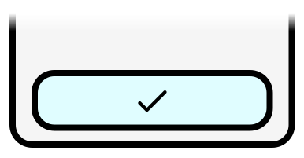
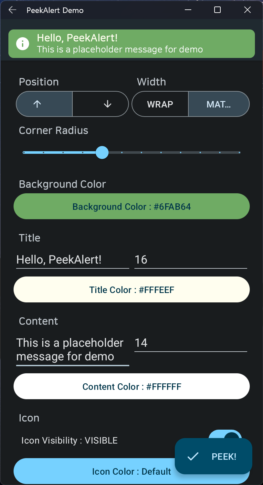
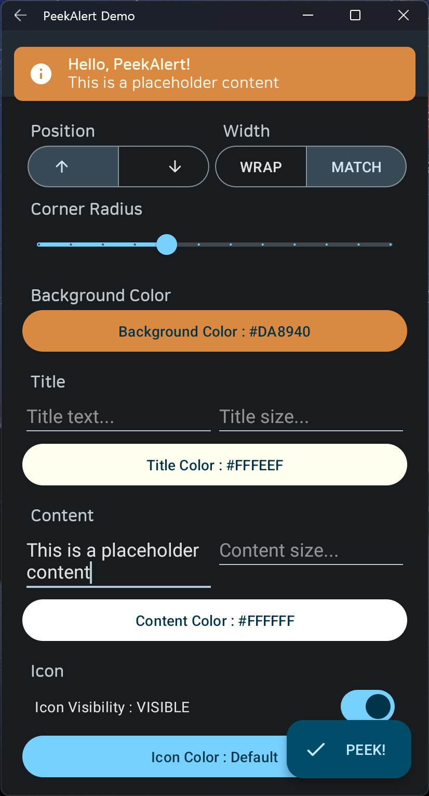
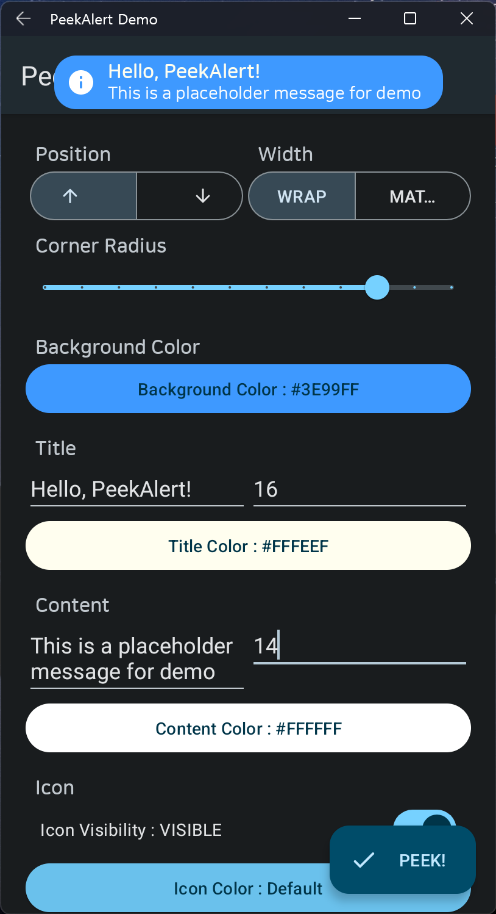

# <h1 align="center"><br>PeekAlert</h1>

<p align="center">
A Lightweight and Highly-customizable alert library
</p>

<p align="center">
    <a href="https://developer.android.com"></a>
    <a href="https://kotlinlang.org/"></a>
    <a href="./"></a>
    <a href="./LICENSE"></a>
</p>

<p align="center">
PeekAlert can be used on both Java and Kotlin.<br>
See the examples below for more info.
</p>

<p align="center">
    ✔ Any PRs are welcome!
</p>

### Demo
<p align="center">
    
    
    
</p>

### Installation (Gradle)
+ Add jitpack url

Kotlin DSL:
```kotlin
repositories {
    /* ... */
    maven(url = "https://jitpack.io")
}
```

Groovy DSL:
```groovy
repositories {
    /* ... */
    maven { url 'https://jitpack.io' }
}
```

+ Add PeekAlert dependency  
[](https://jitpack.io/#mooner1022/PeekAlert)
```kotlin
dependencies {
    implementation("com.github.mooner1022:PeekAlert:<VERSION>")
}
```

### Usage
#### Basic usages

Java
```java
PeekAlert peekAlert = PeekAlert.create(this)
                .setDraggable(true)
                .setTitle("Hello, PeekAlert!")
                .setText("Lorem ipsum dolor sit amet, consectetur adipiscing elit.");

peekAlert.peek();
```
Kotlin
```kotlin
val peekAlert = PeekAlert.create(this)
            .setDraggable(true)
            .setTitle("Hello, PeekAlert!")
            .setText("Lorem ipsum dolor sit amet, consectetur adipiscing elit.")

peekAlert.peek()
```

Builder for kotlin is also available:
```kotlin
createPeekAlert(this) {
    draggable = true
    title("Hello, PeekAlert Builder!") {
        textColor(res = R.color.black)
    }
    text("Lorem ipsum dolor sit amet, consectetur adipiscing elit.") {
        textSize = 14f
    }
}.peek()
```

#### Several alerts at once

Alerts are independent: showing or hiding one leaves the others as they are. Alerts shown at the same position of
the same window form a deck. The newest is in front at its full size, and the older ones are tucked behind it, a
little smaller, with only their edge showing, so a burst of alerts takes about the room of one. A tap on a deck of
more than one spreads it out for a few seconds, each alert in full, to be read or swiped away; then it folds back.

```kotlin
// At most this many in a deck; one more makes the oldest leave. 3 by default.
PeekAlert.maxVisible = 3
```

#### Where an alert is shown

An alert keeps clear of the status bar, the navigation bar, a display cutout and the keyboard by itself, whether or
not the window draws edge to edge.

```kotlin
PeekAlert.create(activity)   // over the activity
PeekAlert.create(fragment)   // over the fragment's activity
PeekAlert.create(dialog)     // over a dialog, such as a bottom sheet; one shown in the activity would be behind it
PeekAlert.create(viewGroup)  // inside a view: a FrameLayout, CoordinatorLayout, ConstraintLayout or RelativeLayout
```

#### More

```kotlin
createPeekAlert(this) {
    position = PeekAlert.Position.Top
    autoHideMillis = 3000L   // made longer where the user asked for more time, in the accessibility settings
    draggable = true         // swipe it toward its edge to dismiss it
    hideOnTouch = false      // or let a tap dismiss it
    text("Saved") {
        maxLines = 4         // the text is cut with an ellipsis past this; 4 by default, 1 for the title
    }
    action("Undo") {
        setOnActionListener { /* ... */ }
    }
    onDismiss { /* the alert left the screen, however it did */ }
}.peek()
```

`peek()` and `hide()` can be called from any thread. `isShowing` tells whether the alert is on screen.

`setMargin` takes dp.

#### How the card looks

```kotlin
createPeekAlert(this) {
    backgroundColor(value = Color.WHITE)
    stroke(res = R.color.outline)   // a line around the card, 1dp wide unless widthDp says otherwise
    elevationDp = 6f                // a shadow under the card; only the alert in front of a deck casts one
    cornerRadius = 14 * density     // px
    paddingDp = 12
    iconSizeDp = 20                 // the size of the icon's drawable by default
    title("Couldn't save") { /* textColor, textSize, typeface, maxLines */ }
    text("The disk is full.")
    action("Details") {
        // With no colors or typeface of its own, the button takes those of the title (of the text where there is
        // no title) and is on a faint wash of that color, so it goes with whatever the card looks like.
        setOnActionListener { /* ... */ }
    }
}.peek()
```

An alert has no line and no shadow unless it is given them: where the card's color is close to what is behind it,
they are what sets it apart.

### Get more info at docs
[Dokka Docs](https://profile.mooner.dev/PeekAlert/-peek-alert/dev.mooner.peekalert/-peek-alert/index.html)


### License
```
MIT License

Copyright (c) 2023 Minki Moon

Permission is hereby granted, free of charge, to any person obtaining a copy
of this software and associated documentation files (the "Software"), to deal
in the Software without restriction, including without limitation the rights
to use, copy, modify, merge, publish, distribute, sublicense, and/or sell
copies of the Software, and to permit persons to whom the Software is
furnished to do so, subject to the following conditions:

The above copyright notice and this permission notice shall be included in all
copies or substantial portions of the Software.

THE SOFTWARE IS PROVIDED "AS IS", WITHOUT WARRANTY OF ANY KIND, EXPRESS OR
IMPLIED, INCLUDING BUT NOT LIMITED TO THE WARRANTIES OF MERCHANTABILITY,
FITNESS FOR A PARTICULAR PURPOSE AND NONINFRINGEMENT. IN NO EVENT SHALL THE
AUTHORS OR COPYRIGHT HOLDERS BE LIABLE FOR ANY CLAIM, DAMAGES OR OTHER
LIABILITY, WHETHER IN AN ACTION OF CONTRACT, TORT OR OTHERWISE, ARISING FROM,
OUT OF OR IN CONNECTION WITH THE SOFTWARE OR THE USE OR OTHER DEALINGS IN THE
SOFTWARE.
```
